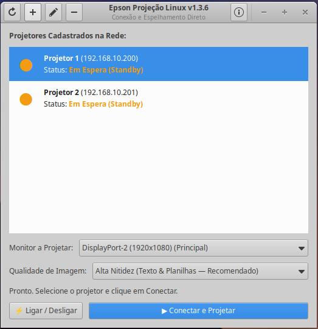

# Epson Projector Linux

🌐 **Language / Idioma:** **English** | [Português (Brasil)](README.pt-BR.md)

[](https://opensource.org/licenses/MIT)
[](https://www.python.org/downloads/)
[](https://www.gtk.org/)
[]()
[](https://github.com/maxxcleiton/epson-projector-linux/releases)

Native Linux application (Ubuntu, Debian, Pop!_OS, Linux Mint, Fedora) for remote control, management, and wireless/network screen mirroring to Epson projectors — **no Wine, Java, or emulators required**.

<p align="center">
  
</p>

---

## 🎯 Motivation

Official Epson software (*EasyMP Network Projection* / *iProjection*) lacks modern native support for Linux distributions. Attempting to run them through Wine frequently fails due to virtual display driver requirements, DirectX/GDI hooks, and proprietary Windows network socket calls.

This project provides a clean, native Python & GTK 3 implementation of Epson's network communication protocols (**ESC/VP.net** and **EasyMP Network Projection**). It enables any Linux workstation or laptop to project its screen over the local network (Wi-Fi or Ethernet) with high performance, minimal latency, and low CPU overhead.

### 🔬 Reverse Engineering (REA)

Because Epson does not provide public documentation or open specifications for the EasyMP video transport protocol or binary control headers, this software was developed through **Reverse Engineering (REA)** of TCP/IP network traffic and client-projector negotiation routines. This enabled the reverse-engineering of the `EEMP0100` handshake (port 3620) and the chunked JPEG video streaming protocol (port 3621), producing a 100% open-source solution free of proprietary binary dependencies.

---

## ✨ Features

- **Real-Time Screen Mirroring**: Screen capture and TCP streaming (ports 3620/3621) with bicubic letterbox downscaling and optimized JPEG compression.
- **Hardware Mouse Pointer Overlay**: Native real-time cursor capture via X11 (`libXfixes`) with anti-aliased alpha blending, ensuring the presenter's mouse pointer is clearly visible to the audience.
- **Power Management (Power ON / Standby)**: Turn projectors on or off directly from the user interface via the ESC/VP.net protocol (port 3629).
- **Smart Busy & Takeover Detection**:
  - Displays real-time projector status: **Free**, **In Use (Busy)**, **Warming Up**, or **Off**.
  - Warns before connecting if another computer is actively projecting and allows taking over the session (*takeover*).
  - Clear notifications if your current session was superseded by another user or if the projector was powered off.
- **Floating Presenter Toolbar**: Discreet always-on-top overlay toolbar with quick Pause and Disconnect controls that stays out of your presentation's way.
- **Zero Audio Distortion**: Negotiates a clean null-audio channel to avoid audio hijacking or interference with system ALSA/PulseAudio devices.
- **Automatic Subnet Discovery**: Scans local network subnets to discover active Epson projectors, with manual IP configuration saved to `~/.config/epson-projector/projectors.json`.

---

## ⚠️ Compatibility and Tested Models

> [!NOTE]
> **Notice on Tested Models and Validation:**
> This software was originally conceived, developed, and tested with a corporate Epson 3LCD projector (native XGA 1024x768 with EasyMP / ESC/VP.net wireless module) available in our environment.
> 
> To date, **it has not yet been extensively tested across all other Epson models and series** (such as widescreen WXGA 1280x800, Full HD 1080p, or laser/home cinema projectors).
> 
> Because Epson standardizes the **EasyMP** (ports 3620/3621) and **ESC/VP.net** (port 3629) protocols across most of its networked product line, it is expected to work on compatible network projectors. If you test this on a different model, **your feedback is warmly welcome**! Please open an *Issue* reporting your projector model and results.

---

## 🏗️ Protocol Architecture

The application communicates directly with the projector firmware across three dedicated TCP channels:

```
+--------------------------------------------------------------------+
|                         Linux Computer                             |
|                                                                    |
|  [ GTK 3 User Interface ] <---> [ Screen Capture + Mouse (XFixes) ]|
+-----------+----------------------+--------------------+------------+
            |                      |                    |
   TCP 3629 |             TCP 3620 |           TCP 3621 |
(ESC/VP.net)|         (EasyMP Ctrl)|     (EasyMP Stream)|
            v                      v                    v
+--------------------------------------------------------------------+
|                         Epson Projector                            |
|                                                                    |
|  - Power ON/OFF           - Session Handshake  - Hardware JPEG     |
|  - Status Queries         - Display Geometry     Decoder           |
|  - Lamp Hours             - Takeover Control   - Frame Buffer      |
+--------------------------------------------------------------------+
```

1. **TCP 3629 (ESC/VP.net)**: ASCII command protocol for power switching (`PWR ON`, `PWR OFF`), power state polling (`PWR?`), and device telemetry.
2. **TCP 3620 (EasyMP Control)**: Session negotiation, screen geometry discovery, and multi-user takeover arbitration.
3. **TCP 3621 (EasyMP Video Stream)**: High-framerate chunked JPEG video transmission.

---

## 📡 Important Wi-Fi Tip (Channels 1–11 vs 12 & 13)

Many Epson projectors use wireless USB adapters (such as *ELPAP07* or *ELPAP10*) with firmware factory-locked to the **US1 (United States)** regulatory domain.

- **The Issue**: In Latin America, Europe, and Asia, 2.4 GHz Wi-Fi networks frequently utilize channels **1 through 13**. Routers configured to "Auto Channel" often select channel **12 or 13**. Projectors with US1 hardware **cannot see or connect to channels 12 or 13**, rendering them undetectable on Wi-Fi.
- **The Solution**: On your Access Point / Router settings, lock the 2.4 GHz radio to a fixed channel between **1 and 11** (recommended: **1, 6, or 11** to prevent channel overlap).

---

## 🚀 Installation & Usage

### Option 1: Download Pre-built `.deb` Package (Recommended)

Download the latest release directly from the [GitHub Releases page](https://github.com/maxxcleiton/epson-projector-linux/releases) and install it:

```bash
sudo dpkg -i epson-projector-linux_*_all.deb
sudo apt-get install -f
```

The application installs to `/usr/share/epson-projector`, provides a launcher at `/usr/bin/epson-projector`, and automatically integrates into your system application menu and desktop.

### Option 2: Build the `.deb` Package Locally

The repository includes a build script to package the app for Debian/Ubuntu-based systems:

```bash
# 1. Clone the repository
git clone https://github.com/maxxcleiton/epson-projector-linux.git
cd epson-projector-linux

# 2. Make the build script executable and compile
chmod +x build_deb.sh
./build_deb.sh

# 3. Install the generated package
sudo dpkg -i epson-projector-linux_*_all.deb
sudo apt-get install -f
```

#### 📦 What the build script does:
- Assembles standard Linux FHS directories in `build_pkg/`:
  - `/usr/share/epson-projector/src/`: Python application modules.
  - `/usr/share/epson-projector/assets/`: Icons and assets.
  - `/usr/bin/epson-projector`: System launcher.
  - `/usr/share/applications/epson-projector.desktop`: Desktop menu entry.
  - `/usr/share/icons/hicolor/64x64/apps/`: Application icon.
- Packages everything cleanly with `dpkg-deb --root-owner-group --build`.
- Installs a `postinst` hook that places an authorized application shortcut on the Desktop of all configured users.

### Option 3: Run Directly from Source (No Installation)

```bash
# 1. Install dependencies
sudo apt update
sudo apt install -y python3 python3-gi gir1.2-gtk-3.0 gir1.2-gdkpixbuf-2.0 python3-pil libx11-6 libxfixes3

# 2. Check Python syntax (optional)
python3 -m py_compile src/*.py

# 3. Run the application
chmod +x run.sh
./run.sh
```

---

## ⚙️ Projector Configuration

Projector profiles are saved to `~/.config/epson-projector/projectors.json`.
You can add projectors through the graphical interface (`+ Adicionar`) or by editing the JSON file directly:

```json
{
  "projectors": [
    {
      "id": "proj-01",
      "name": "Main Meeting Room",
      "ip": "192.168.1.100",
      "mac": "",
      "port_escvp": 3629,
      "port_easymp": 3620,
      "port_stream": 3621
    }
  ],
  "fps": 20,
  "quality": 90
}
```

---

## 📜 Version History (Changelog)

### **v1.3.6**
- **Seamless "Starting Up..." Power Transition**: When powering on a projector from Standby, the interface immediately reports "Starting Up... (Please wait)" with a vibrant status indicator, preventing the transient hardware network reboot from momentarily flashing a false "Disconnected" error before lamp warmup.
- **Projector Profile Editing & Removal**: Added an Edit Projector button (and double-click shortcut on the list) allowing users to rename projectors or update IP addresses on the fly, as well as a Remove button to delete obsolete projectors from the configuration.

### **v1.3.5**
- **Critical Mouse Cursor Fix (64-bit LP64)**: Fixed memory alignment calculation when reading pixel data from `libXfixes`. In x86_64 architecture, cursor pixels use `unsigned long` (8 bytes per pixel), while color data resides in 32-bit integers. Adjusting the pixel stride eliminated the jagged/comb artifact, delivering a crisp, perfectly anti-aliased cursor arrow.

### **v1.3.4**
- **Mouse Cursor Overlay Support**: Added real-time operating system cursor capture using X11 `libXfixes` and `ctypes`, blending the pointer onto video frames before transmission.

### **v1.3.3**
- **High-Contrast Interface Theme**: Refined theme palette to distinguish between "In Use" badges and selected rows in the projector list.

### **v1.3.2**
- **Flicker-Free Periodic Reload**: Optimized GTK list refresh to update existing row labels in-place rather than rebuilding widgets, eliminating list selection flickering.

### **v1.3.1**
- **Disconnect Reason Classification**: Explicitly distinguishes between remote takeover disconnects and projector power-down events.

### **v1.3.0**
- **Busy Detection & Takeover Management**:
  - Pre-connection port check to detect ongoing projections.
  - "In Use" status indicator in the main list.
  - Confirmation dialog before taking over an occupied projector.
  - Graceful disconnection notice when superseded by another presenter.

### **v1.2.5**
- **Audio Channel Muting & Network Discovery**: Silent audio stream negotiation and asynchronous local subnet scanning.

### **v1.2.0**
- **Floating Presenter Toolbar**: Added an always-on-top presenter bar with one-click Pause and Disconnect actions.

### **v1.1.0**
- **Native GTK 3 User Interface**: Added graphical dashboard with projector list, lamp hours, and Power ON/OFF controls via ESC/VP.net.

### **v1.0.0**
- **Initial Release**: Core reverse-engineered implementation of ESC/VP.net (TCP 3629) and EasyMP streaming (TCP 3620/3621) in pure Python.

---

## 🤝 Contributing

Contributions, bug reports, and pull requests are very welcome! If you test this software on other Epson models, please share your experience by opening an issue.

## 📄 License

This project is licensed under the **MIT License** — see the [LICENSE](LICENSE) file for details.
